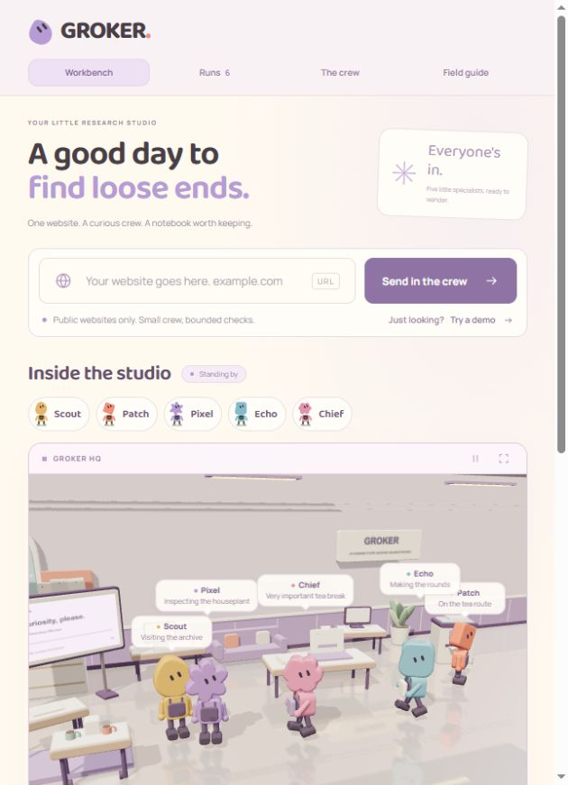
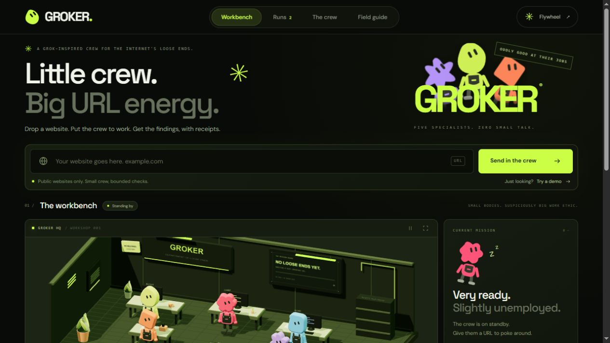

# GROKER

Website inspector with a five-character crew and an evidence-backed report.


[Deploy](#deploy-on-vercel) · [How it runs](#how-it-runs) · [Local preview](#local-preview) · [What it checks](#what-it-checks) · [Optional Grok](#optional-grok-summary)

Paste a public URL. GROKER crawls same-origin HTML, links and resources, verifies what is actually missing, and returns one finished report — grade, findings, page graph, headers, inventory and receipts. The room animation is just theatre while that request is in flight; history lives in the browser.

<p align="center">
  
</p>

---

## How it runs

Same shape as a serverless desk: one request in, one report out.

1. Browser `POST /api/index` with `{"action":"inspect","url":"https://example.com/"}`.
2. The function gathers evidence, re-checks missing responses, and returns the full report. No background jobs. No report files on disk.
3. The room animates an **estimated** progress bar — not live telemetry, never 100% before the answer.
4. The last 20 completed reports stay in `localStorage` (quota trims older ones). JSON export is a separate copy.

Run URLs are **browser-local bookmarks**, not public shares. They do not sync across devices. Keep the tab open until the response lands; refresh / navigate / **Stop waiting** drops the in-flight result.

Evidence budget: **38s** (plus per-request timeouts). Over budget → unchecked URLs marked unavailable and excluded from the score, with coverage called out. Optional model summary: separate **10s**, falls back to the code summary. At most two inspections per Python process (not a global rate limit).

---

## Deploy on Vercel

Import [GreshamTrade/groker](https://github.com/GreshamTrade/groker). Root is this repository.

| Setting | Value |
| --- | --- |
| Framework | Other |
| Build / Install | leave empty (`vercel.json` already disables them) |
| Output Directory | `public` |
| Python | 3.12 (`.python-version`) |

`api/index.py` is the function. `vercel.json` bundles `server.py` + `reporting.py`, caps duration at 60s, and rewrites `/crew`, `/guide`, `/runs` (and run ids) to the SPA.

---

## Optional Grok summary

Vercel → Environment Variables → redeploy:

```text
GROKER_XAI_API_KEY=your-key
GROKER_XAI_MODEL=your-enabled-model-id
```

Both optional. Scanning and rich reports work without them. The key stays server-side. Demo runs never call a model. Only collected inspection evidence goes to `api.x.ai`.

---

## Local preview

Python 3.10+, no pip packages:

```bash
python server.py --port 5174
```

Open http://127.0.0.1:5174 — same engine as the Vercel function.

```bash
python -m unittest discover -s tests -v
node --test tests/archive.test.cjs
```

---

## What it checks

Up to **8** public HTML pages, **28** same-origin links, **16** resources: responses, missing assets, title/description/lang/viewport, headings, image alt, delivery details. Missing targets are requested again. Private/local destinations and private redirects are rejected; TLS stays on.

Report: sample-health grade, main finding, page graph, weighted checks, per-page notebooks, headers, inventory, prioritized fixes, agent notes, evidence receipts. Unknown checks are out of the score. Confirmed missing pages/resources cap the grade at **74 (C)**.

Does **not**: execute JavaScript, screenshot, submit forms, log in, measure Core Web Vitals, audit security, or certify accessibility.

<p align="center">
  
</p>

Three.js (MIT) is vendored under `public/vendor/`. Baloo 2 and Manrope (OFL) under `public/fonts/`.
